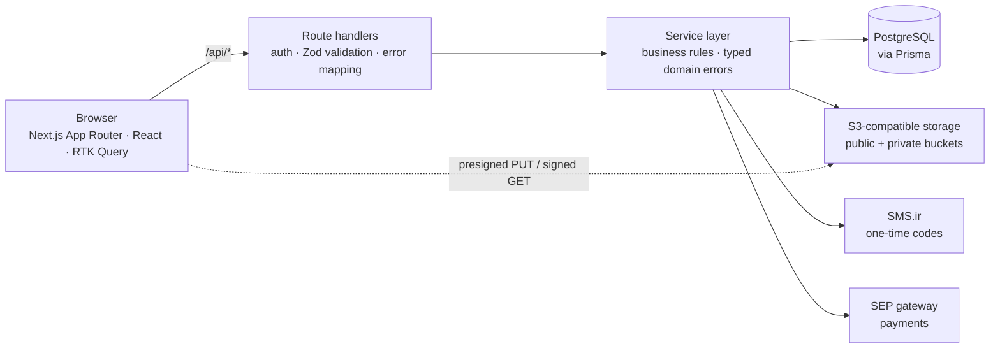
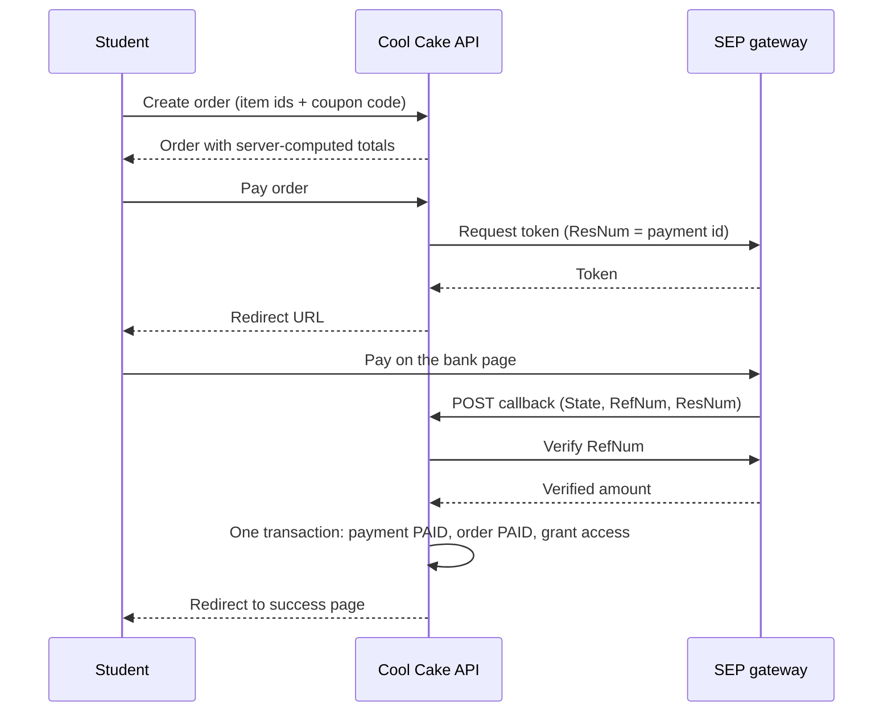

# 🍰 Cool Cake — Baking Course Platform

**A full-stack, Persian-first (RTL) e-learning platform where students buy and watch pastry and cake courses. Designed, built and shipped solo in about 25 days, and live in production.**

🔗 **Live site:** [cool-cake.ir](https://cool-cake.ir)

|                 |                                                                                                                  |
| --------------- | ---------------------------------------------------------------------------------------------------------------- |
| **Role**        | Sole developer: frontend, backend, database, payments, storage, deployment                                       |
| **Timeline**    | About 25 days from start to production                                                                           |
| **Scale today** | 80 courses · 5 course bundles · 123 registered users                                                             |
| **Stack**       | Next.js (App Router) · TypeScript · Prisma · PostgreSQL · Redux Toolkit / RTK Query · Tailwind CSS · better-auth |
| **Source code** | Private (client project). Happy to walk through any part of it on a call.                                        |

> This repository is a showcase: it contains documentation, screenshots and trimmed code excerpts only. Snippets below are simplified for readability.

---

## Screenshots

> Personal data in the screenshots (names, phone numbers, emails, revenue) is blurred or replaced with demo data.

| Home                                         | Course page                                      |
| -------------------------------------------- | ------------------------------------------------ |
|  |  |

| Search with grouped autocomplete                    | Bundle page                                 |
| --------------------------------------------------- | ------------------------------------------- |
|  |  |

| Cart with coupon field             | Student reviews and results                              |
| ---------------------------------- | -------------------------------------------------------- |
|  |  |

| Mobile: "What should I bake today?"           | Mobile: phone-number login                  |
| --------------------------------------------- | ------------------------------------------- |
|  |  |

| Student dashboard                                            | Admin dashboard                                          |
| ------------------------------------------------------------ | -------------------------------------------------------- |
|  |  |

| Admin: course creation wizard                       | Admin: course management                       |
| --------------------------------------------------- | ---------------------------------------------- |
|  |  |

---

## What it does

### For students

- **Browse and discover:** courses, categories, tags and bundles, with a guided **"What should I bake today?"** finder (by available time, type of dessert and ingredients on hand).
- **Search:** full-text search with ranking, filters, sorting, and grouped autocomplete (courses, categories, tags, ingredients).
- **Phone-first accounts:** sign in with a mobile number and an SMS one-time code.
- **Cart and checkout:** persistent cart, discount codes, and online payment through the SEP (Saman) bank gateway.
- **Learning:** protected video lessons with resume-where-you-left-off, downloadable recipe PDFs, step-by-step recipes and ingredient lists.
- **Community:** moderated reviews with admin replies, questions and answers, and student result photos.
- **Personal dashboard:** my courses, wishlist, reviews, questions, results, discount codes, and profile.

### For the admin

- **Dashboard:** revenue trend, successful and pending orders, new users and discount usage, with 7, 30 and 90-day ranges and comparison to the previous period.
- **Content management:** categories, tags, ingredients and units, bundles, hero slides (with CTAs that link to a course, bundle, category or tag), and FAQ-style site content.
- **Course creation wizard:** six steps (basics and pricing → media → tags → ingredients → recipe → publish), draft first.
- **People and moderation:** users (search, roles, ban state, grant or revoke course access), course reviews, site reviews, student results, and Q&A answering.
- **Discount codes:** percentage or fixed, minimum order, cap, usage limit, validity window, and per-user targeting.

---

## Tech stack

| Layer               | Technology                                                                           |
| ------------------- | ------------------------------------------------------------------------------------ |
| Framework           | Next.js App Router, React, TypeScript                                                |
| UI                  | Tailwind CSS, shadcn/ui, Framer Motion, lucide-react                                 |
| Client state / data | Redux Toolkit, RTK Query (tag-based caching and invalidation)                        |
| API                 | Next.js route handlers, Zod validation, a service layer with typed domain errors     |
| Database            | PostgreSQL with Prisma (31 models), full-text search via `tsvector`                  |
| Auth                | better-auth (phone-number OTP, admin plugin, roles) with SMS.ir                      |
| Payments            | SEP (Saman) gateway behind an adapter, plus a TEST gateway for development           |
| Storage             | S3-compatible object storage (Liara) with public and private buckets, presigned URLs |
| Video               | video.js                                                                             |
| Hosting             | Runflare                                                                             |

---

## Architecture



**Layering rule:** route handlers only authenticate, validate input with Zod and translate domain errors into HTTP status codes. All business rules live in services. Only one module knows about the storage provider, and only gateway adapters know about the bank.

```ts
// Route handler: thin, predictable
const parsed = UpdateCourseSchema.safeParse(await req.json());
if (!parsed.success)
  return NextResponse.json({ error: "ورودی نامعتبر" }, { status: 400 });

try {
  return NextResponse.json(await updateCourse(id, parsed.data));
} catch (err) {
  if (err instanceof CourseNotFoundError)
    return NextResponse.json({ error: err.message }, { status: 404 });
  if (err instanceof CourseSlugTakenError)
    return NextResponse.json({ error: err.message }, { status: 409 });
  throw err;
}
```

---

## Engineering highlights

### 1. Paid video and PDFs never leave the server as permanent links

**Problem:** Students pay for videos and recipe PDFs. A public URL in an API response would be shared within hours.

**Approach:**

- Private files live in a **private bucket**. The API **never returns their storage keys**, only `hasMainVideo` / `hasRecipePdf` booleans.
- The player asks `GET /api/courses/:id/protected-file`, which checks login → course → published state → admin or purchased access (free courses are open), and only then returns a **short-lived signed URL**.
- TTLs are chosen per file type: 5 minutes for PDFs, 4 hours for video so a long lesson does not expire mid-watch.
- Signing for the private bucket follows the provider's virtual-hosted style, and the visible host is swapped to a custom download domain while the signature stays valid.

```ts
// Serializer: paid files are never exposed, only a flag
function serializeCourse({ mainVideo, recipePdf, ...rest }) {
  return { ...rest, hasMainVideo: !!mainVideo, hasRecipePdf: !!recipePdf };
}

// GET /api/courses/:id/protected-file?type=video|recipe-pdf
const isAdmin = session.user.role === "admin";
const isFree = course.basePrice === 0 || course.salePrice === 0;

if (!isAdmin && course.status !== "PUBLISHED") return notFound();
if (!isAdmin && !isFree && !(await hasCourseAccess(session.user, id)))
  return forbidden();

const url = await getSignedDownloadUrlForKey(key, "private", ttlFor(type));
return NextResponse.json({ url }, { headers: { "Cache-Control": "no-store" } });
```

### 2. A storage layer that cannot drift away from the database

**Problem:** With direct browser uploads, files can be uploaded and never saved, replaced, or orphaned when a record is deleted. Deleting files inline with DB writes risks corrupting a successful transaction when the storage call fails.

**Approach:**

- **One module** talks to the provider (`s3.storage.ts`). Everything else works with a _scope_ (`public` / `private`) and a _key_. Moving to another S3-compatible provider means changing environment variables.
- **Keys are generated only on the server** (UUID under a per-purpose prefix). Each upload purpose declares its bucket scope, allowed MIME types, whether a course id is required, and whether only admins may request it.
- Browsers upload **directly to the bucket** through presigned PUT URLs, so large files never pass through the Next.js server.
- A `StorageObject` registry keeps a **reference count** per key. References are attached and released _inside the same transaction_ as the field update.
- Physical deletion is **never inline**. A cleanup job deletes objects that stayed unreferenced past a grace period, and re-checks each row before deleting.

```ts
[UploadPurpose.COURSE_MAIN_VIDEO]: {
  scope: "private",
  keyPrefix: (ctx) => `videos/courses/${ctx.courseId}/main`,
  allowedMimeTypes: ["video/mp4", "video/webm"],
  requiresCourseId: true,
  adminOnly: true,
},

await prisma.$transaction(async (tx) => {
  await tx.course.update({ where: { id }, data: { thumbnail: input.thumbnail } });
  // release the old key, attach the new one, atomically with the update
  await syncSingleKeyReference(existing.thumbnail, input.thumbnail, "public", tx);
});

// atomic decrement: concurrent releases cannot lose a count
export async function releaseReference(key: string | null | undefined, db: Db = prisma) {
  if (!key) return;
  const { count } = await db.storageObject.updateMany({
    where: { key, referenceCount: { gt: 0 } },
    data: { referenceCount: { decrement: 1 } },
  });
  if (count === 0) return;
  await db.storageObject.updateMany({
    where: { key, referenceCount: 0 },
    data: { unreferencedAt: new Date() }, // the cleanup job only touches rows past the grace period
  });
}
```

### 3. Payments: server-side pricing and idempotent finalization

**Problem:** A payment flow has to be correct even if the user refreshes, the bank calls back twice, or someone tampers with the request.

**Approach:**

- **The server decides every price.** Order items are rebuilt from the database (`salePrice ?? basePrice`) and stored as **snapshots** (title and price at purchase time). The client's cart is only for display.
- Coupons are validated against the live subtotal: validity window, minimum order, usage limit, per-user single use, user-targeted codes, and a cap for percentage discounts.
- The gateway sits behind an **adapter interface**: SEP in production, a TEST gateway for development.
- The bank callback is **not trusted**. The server verifies the `RefNum` with SEP, compares the verified **amount** with the order, and enforces a **unique receipt number** to block replay.
- Finalization runs in **one transaction** guarded by a status condition (`PENDING → PAID`), so concurrent or repeated finalizations cannot double-grant access. Network calls to the bank never happen inside a DB transaction.
- Abandoned attempts expire (payments after 20 minutes, orders after 60), so a user retrying a payment never loses their order.



```ts
// Gateway adapter: the only code that knows SEP's API
export const sepGateway: PaymentGatewayAdapter = {
  gateway: "SEP",
  async getRedirectUrl(payment) {
    const res = await fetch(SEP_TOKEN_URL, {
      method: "POST",
      headers: { "Content-Type": "application/json" },
      body: JSON.stringify({
        action: "token",
        TerminalId: SEP_TERMINAL_ID,
        Amount: payment.amount, // integer, Rial
        ResNum: payment.id, // unique per attempt: used to match the callback
        RedirectUrl: SEP_CALLBACK_URL,
      }),
    });
    const data = (await res.json()) as SepTokenResponse;
    if (data.status !== 1 || !data.token)
      throw new Error(data.errorDesc || "خطا در اتصال به درگاه پرداخت");
    return {
      url: `https://sep.shaparak.ir/OnlinePG/SendToken?token=${data.token}`,
      authority: data.token,
    };
  },
};

// Callback: verify with the bank, never with the browser
if (payment.status === "PAID")
  return { status: "PAID", orderId: payment.orderId }; // repeat callback is a no-op
const verified = await verifyWithSep(refNum);
if (
  !verified.Success ||
  verified.OriginalAmount !== tomanToRial(Number(payment.amount))
) {
  await finalizePaymentFailure(payment.id);
  return { status: "FAILED", orderId: payment.orderId };
}

// Finalization: exactly one winner
const updated = await prisma.$transaction(async (tx) => {
  const claimed = await tx.payment.updateMany({
    where: { id: payment.id, status: "PENDING" },
    data: { status: "PAID", paidAt: now },
  });
  if (claimed.count === 0) return null; // someone else already finalized it

  await tx.order.updateMany({
    where: { id: order.id, status: { not: "PAID" } },
    data: { status: "PAID", paidAt: now },
  });
  for (const item of order.items) {
    if (item.courseId)
      await grantCourseAccess(tx, {
        userId,
        courseId: item.courseId,
        source: "DIRECT_PURCHASE",
      });
    else if (item.bundleId)
      await grantBundleAccess(tx, { userId, bundleId: item.bundleId });
  }
  return tx.order.findUniqueOrThrow({
    where: { id: order.id },
    include: { items: true },
  });
});
```

### 4. Full-text search for Persian without a Persian dictionary

**Problem:** PostgreSQL ships no Persian text-search configuration, and a plain `contains` filter gives neither ranking nor speed.

**Approach:**

- `tsvector` columns are **generated and stored** in the database, with the `simple` configuration (tokenize and lowercase, no English stemming) and **weights** (title › short description › description), each backed by a **GIN index**.
- One ranked query combines matches from courses, their category, tags and ingredients, with lower weights for indirect matches.
- Raw SQL goes through `Prisma.sql` as a **bound parameter**, and user input is sanitized into a valid prefix query, so typing "کی" already finds "کیک".
- Autocomplete returns **grouped suggestions** (courses, categories, tags, ingredients), each matched on its own name.

```sql
ALTER TABLE "Course"
  ADD COLUMN "searchVector" tsvector
  GENERATED ALWAYS AS (
    setweight(to_tsvector('simple', coalesce("title", '')), 'A') ||
    setweight(to_tsvector('simple', coalesce("shortDescription", '')), 'B') ||
    setweight(to_tsvector('simple', coalesce("description", '')), 'C')
  ) STORED;

CREATE INDEX "Course_searchVector_idx" ON "Course" USING GIN ("searchVector");
```

```ts
// Raw input -> safe prefix tsquery ("choco" matches "chocolate")
export function buildTsQuery(raw: string): string | null {
  const tokens = normalizePersian(raw) // Arabic ي/ك -> Persian ی/ک, half-space -> space
    .split(/\s+/)
    .map((t) => t.replace(/[^\p{L}\p{N}]/gu, "")) // strip every tsquery operator character
    .filter(Boolean);

  return tokens.length ? tokens.map((t) => `${t}:*`).join(" & ") : null;
}
```

### 5. A video player that survives expiring links

**Problem:** Signed URLs expire. A viewer who pauses for a long time or watches a long lesson should not hit an error screen, and progress should not be lost.

**Approach:**

- A video.js player wrapped in React. Callbacks are kept in refs, so the player is created once and never rebuilt on re-render.
- **Self-healing:** on a playback error, the player asks the API for a fresh signed URL, swaps the source, and **resumes at the same second**.
- **Progress tracking:** reported every N seconds, and also on pause, on end, and on unmount. The server never lets progress move backwards, and marks a course complete at 95%.
- Casual downloading is discouraged (`nodownload`, no Picture-in-Picture, no context menu).

```tsx
player.on("error", async () => {
  if (hasRetriedRef.current || !refreshSrcRef.current) return;
  hasRetriedRef.current = true;

  const resumeAt = player.currentTime() ?? 0;
  try {
    const freshUrl = await refreshSrcRef.current();
    player.error(null);
    player.src({ src: freshUrl, type: "video/mp4" });
    player.one("loadedmetadata", () => {
      hasRetriedRef.current = false; // allow another recovery later in the session
      player.currentTime(resumeAt);
      player.play()?.catch(() => {});
    });
  } catch {
    /* keep the original error visible */
  }
});

const reportProgress = () => {
  const duration = player.duration();
  if (!Number.isFinite(duration)) return; // metadata not loaded yet
  onProgressRef.current?.(player.currentTime() ?? 0, duration);
};
player.on("pause", reportProgress);
```

### 6. Phone-first authentication

- Students sign in with a **mobile number and an SMS code** (better-auth phone-number plugin, codes sent through SMS.ir). The account is created on first successful verification.
- Roles come from the better-auth admin plugin. Admin routes go through a single `requireAdmin` guard that distinguishes "not logged in" (401) from "not allowed" (403).
- Profile fields (first name, last name, birth date, gender) are additional typed user fields shared between server and client.

```ts
export async function requireAdmin(req: NextRequest) {
  const session = await auth.api.getSession({ headers: req.headers });
  if (!session)
    return NextResponse.json({ error: "ابتدا وارد شوید" }, { status: 401 });
  if (session.user.role !== "admin")
    return NextResponse.json({ error: "دسترسی غیرمجاز" }, { status: 403 });
  return session;
}
```

### 7. Admin course wizard: draft first, partial updates

- Step 1 creates a minimal **DRAFT** course. Every later step is a `PATCH` with only the fields that changed.
- The update schema has explicit semantics: **omitted = untouched · `null` = clear the file · array = replace the whole set**. Relations (tags, ingredients, images) are replaced inside a single transaction, together with their storage references.
- Referenced tags, ingredients and units are validated before anything is written. Storage objects are verified to exist before their keys are saved.

```ts
export const UpdateCourseSchema = z.object({
  thumbnail: z.string().min(1).nullable().optional(), // null clears the file
  salePrice: z.number().int().nonnegative().nullable().optional(),
  tagIds: z.array(z.string().min(1)).max(20).optional(), // replaces the whole set
  ingredients: z.array(CourseIngredientInputSchema).max(100).optional(),
  status: z.enum(["DRAFT", "PUBLISHED", "ARCHIVED"]).optional(),
});
```

### 8. Frontend craft: RTL, Persian formatting, accessibility, SEO

- **Right-to-left from the ground up:** layouts, carousels, directional icons and motion are designed for RTL. Numbers, prices, durations and dates use `Intl.NumberFormat("fa-IR")` and Persian "folio" numerals.
- **Responsive:** mobile bottom navigation, swipe carousels with snap and a peek of the next card, a sticky purchase bar on course and bundle pages.
- **Accessible carousels:** ARIA roles and labels, keyboard arrows, radio-group semantics for the finder, and `prefers-reduced-motion` support.
- **Loading states:** skeletons everywhere, `next/image` with sizes and priority for above-the-fold images.
- **SEO:** per-page metadata with canonical URLs and Open Graph images, request-level deduplication with React `cache()`, and proper `notFound()` handling.
- **RTK Query:** tag-based caching and invalidation, so admin edits refresh exactly the affected lists and details.

```ts
const numberFormatter = new Intl.NumberFormat("fa-IR");
export const formatPrice = (amount: number) =>
  `${numberFormatter.format(amount)} تومان`;
```

---

## Data model

31 Prisma models in a normalized PostgreSQL schema:

- **Identity:** `User`, `Session`, `Account`, `Verification`
- **Catalog:** `Category`, `Tag`, `Course`, `CourseTag`, `CourseImage`, `Ingredient`, `Unit`, `CourseIngredient`, `Recipe`, `RecipeStep`, `Bundle`, `BundleCourse`, `HeroSlide`
- **Commerce:** `Order`, `OrderItem` (price snapshots), `Payment`, `Coupon`, `CouponUser`
- **Learning and community:** `CourseAccess`, `CourseProgress`, `Wishlist`, `CourseReview`, `CourseQuestion`, `CourseAnswer`, `StudentSubmission`, `SiteReview`
- **Infrastructure:** `StorageObject` (file registry with reference counts)

Design choices worth noting: purchased access is a separate `CourseAccess` row with a _source_ (direct purchase, bundle purchase, admin grant); moderated content uses status enums; money and ratings are validated and recomputed on the server.

---

## Project facts

- **Solo delivery in about 25 days**, from empty repository to a live, paying platform.
- **Production data:** 80 courses, 5 bundles, 123 registered users.
- **Client project:** built for a pastry-education business, with real customers and real payments.

## Roadmap

- Direct browser uploads for protected videos and PDFs (the presigned pipeline already supports them).
- Adaptive streaming for long lessons.
- Search normalization applied at the index level, not only at query time.

---

## About me

**[Alireza Rezapour]** · Web developer · [https://github.com/Alireza-Rezapour] · [alirezarezapoor33@gmail.com]

If you would like a walkthrough of the code, the architecture or any of the decisions above, I would be glad to show it.
