# 🍰 Cool Cake — Baking Course Platform

**A full-stack, Persian-first (RTL) e-learning platform where students buy and watch pastry and cake courses. Designed, built and shipped solo in about 25 days, and live in production.**

🔗 **Live site:** [cool-cake.ir](https://cool-cake.ir)

|                 |                                                                                                                  |
| --------------- | ---------------------------------------------------------------------------------------------------------------- |
| **Role**        | Sole developer: frontend, backend, database, payments, storage, deployment                                       |
| **Timeline**    | About 25 days from start to production                                                                           |
| **Scale today** | 80 courses · 5 course bundles · 123 registered users                                                             |
| **Stack**       | Next.js (App Router) · TypeScript · Prisma · PostgreSQL · Redux Toolkit / RTK Query · Tailwind CSS · better-auth |
| **Source code** | Private (client project). Happy to walk through any part of it on a call.                                        |

> This repository is a showcase: it contains documentation, screenshots and trimmed code excerpts only. Snippets below are simplified for readability.

---

## Screenshots

> Personal data in the screenshots (names, phone numbers, emails, revenue) is blurred or replaced with demo data.

| Home                                         | Course page                                      |
| -------------------------------------------- | ------------------------------------------------ |
| 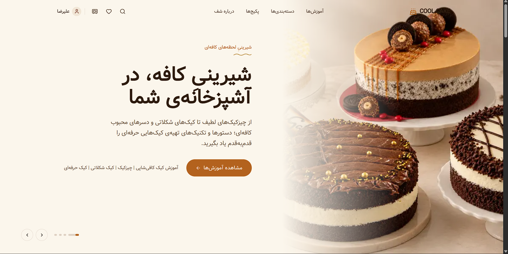 | 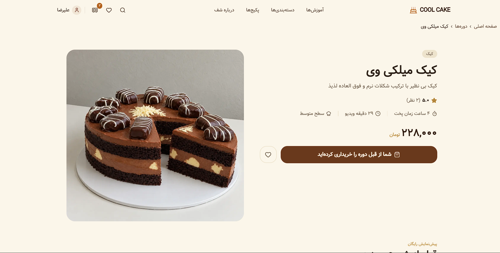 |

| Search with grouped autocomplete                    | Bundle page                                 |
| --------------------------------------------------- | ------------------------------------------- |
| 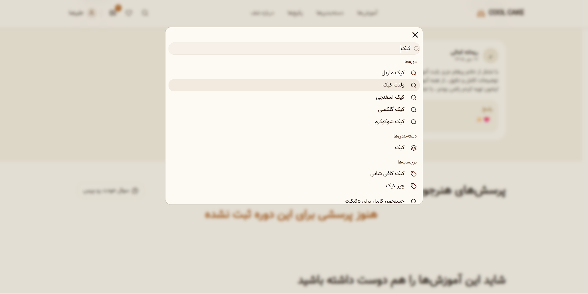 | 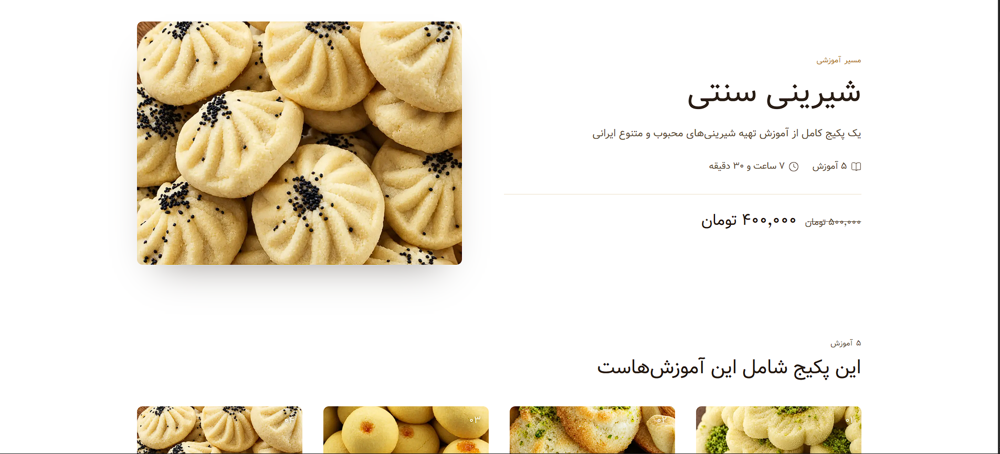 |

| Cart with coupon field             | Student reviews and results                              |
| ---------------------------------- | -------------------------------------------------------- |
| 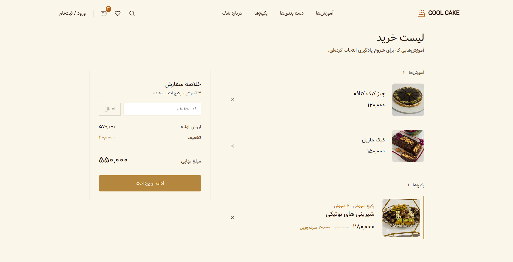 | 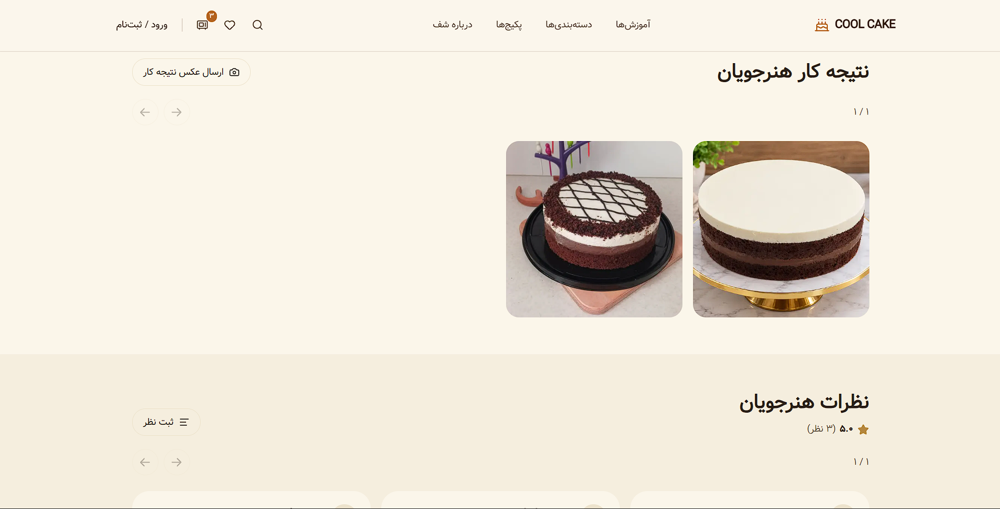 |

| Mobile: "What should I bake today?"           | Mobile: phone-number login                  |
| --------------------------------------------- | ------------------------------------------- |
| 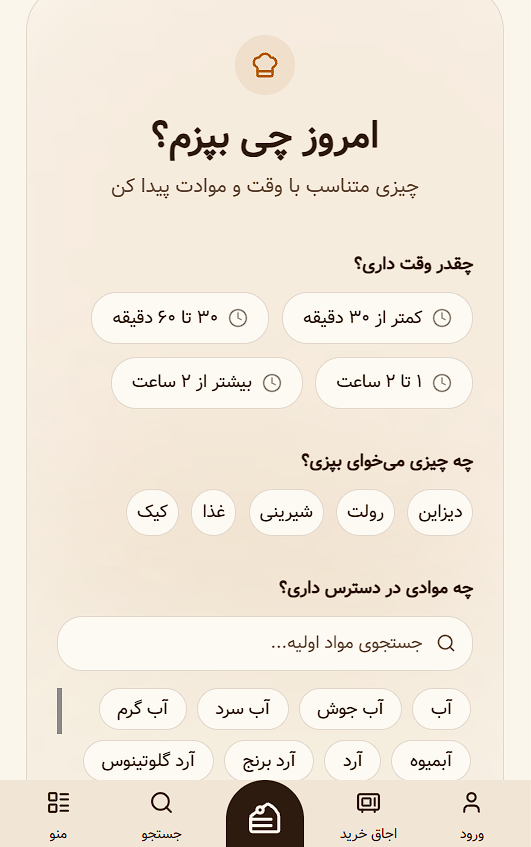 | 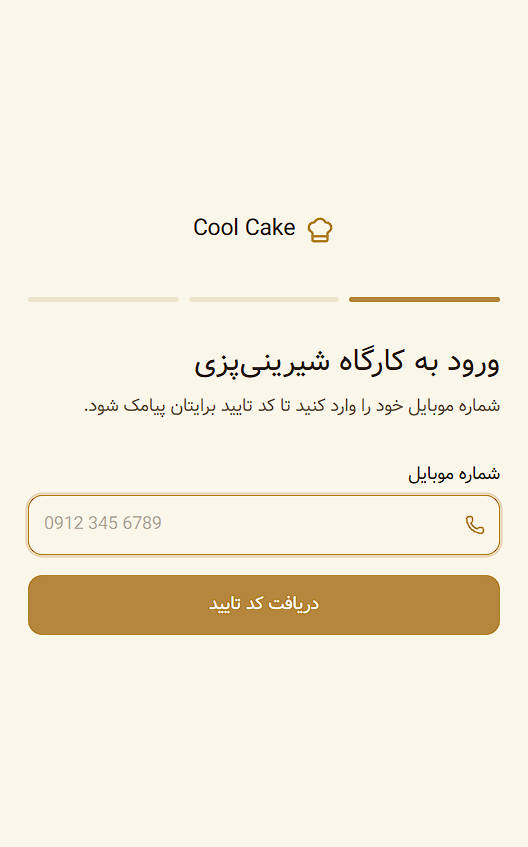 |

| Student dashboard                                            | Admin dashboard                                          |
| ------------------------------------------------------------ | -------------------------------------------------------- |
| 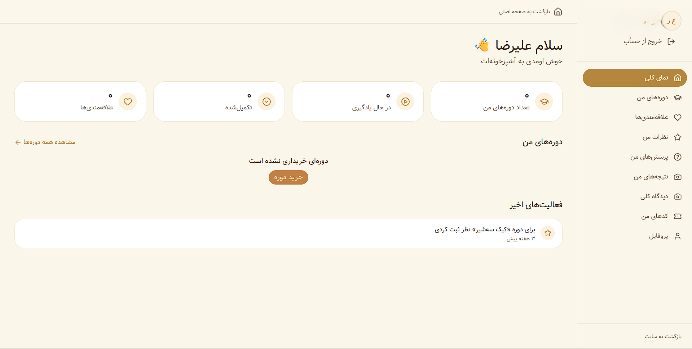 | 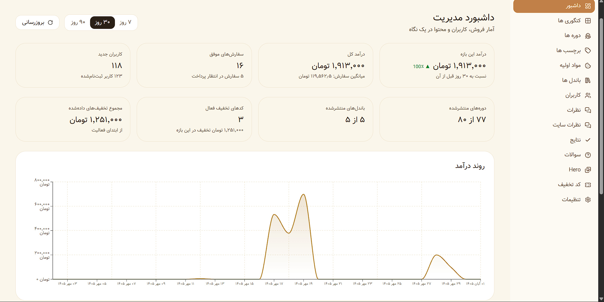 |

| Admin: course creation wizard                       | Admin: course management                       |
| --------------------------------------------------- | ---------------------------------------------- |
| 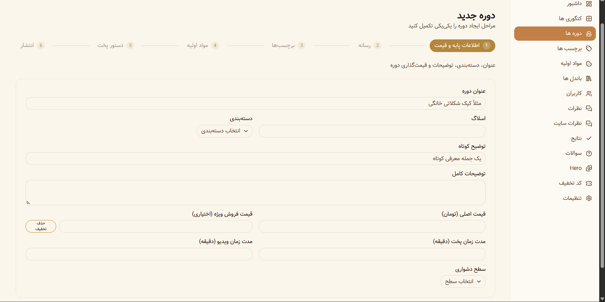 | 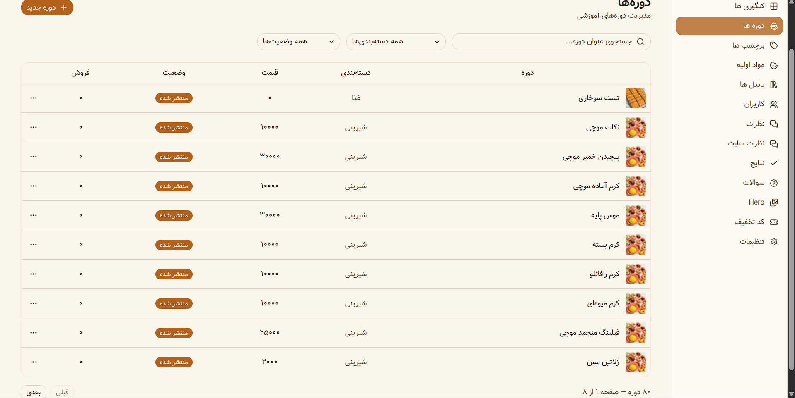 |

---

## What it does

### For students

- **Browse and discover:** courses, categories, tags and bundles, with a guided **"What should I bake today?"** finder (by available time, type of dessert and ingredients on hand).
- **Search:** full-text search with ranking, filters, sorting, and grouped autocomplete (courses, categories, tags, ingredients).
- **Phone-first accounts:** sign in with a mobile number and an SMS one-time code.
- **Cart and checkout:** persistent cart, discount codes, and online payment through the SEP (Saman) bank gateway.
- **Learning:** protected video lessons with resume-where-you-left-off, downloadable recipe PDFs, step-by-step recipes and ingredient lists.
- **Community:** moderated reviews with admin replies, questions and answers, and student result photos.
- **Personal dashboard:** my courses, wishlist, reviews, questions, results, discount codes, and profile.

### For the admin

- **Dashboard:** revenue trend, successful and pending orders, new users and discount usage, with 7, 30 and 90-day ranges and comparison to the previous period.
- **Content management:** categories, tags, ingredients and units, bundles, hero slides (with CTAs that link to a course, bundle, category or tag), and FAQ-style site content.
- **Course creation wizard:** six steps (basics and pricing → media → tags → ingredients → recipe → publish), draft first.
- **People and moderation:** users (search, roles, ban state, grant or revoke course access), course reviews, site reviews, student results, and Q&A answering.
- **Discount codes:** percentage or fixed, minimum order, cap, usage limit, validity window, and per-user targeting.

---

## Tech stack

| Layer               | Technology                                                                           |
| ------------------- | ------------------------------------------------------------------------------------ |
| Framework           | Next.js App Router, React, TypeScript                                                |
| UI                  | Tailwind CSS, shadcn/ui, Framer Motion, lucide-react                                 |
| Client state / data | Redux Toolkit, RTK Query (tag-based caching and invalidation)                        |
| API                 | Next.js route handlers, Zod validation, a service layer with typed domain errors     |
| Database            | PostgreSQL with Prisma (31 models), full-text search via `tsvector`                  |
| Auth                | better-auth (phone-number OTP, admin plugin, roles) with SMS.ir                      |
| Payments            | SEP (Saman) gateway behind an adapter, plus a TEST gateway for development           |
| Storage             | S3-compatible object storage (Liara) with public and private buckets, presigned URLs |
| Video               | video.js                                                                             |
| Hosting             | Runflare                                                                             |

---

## Architecture

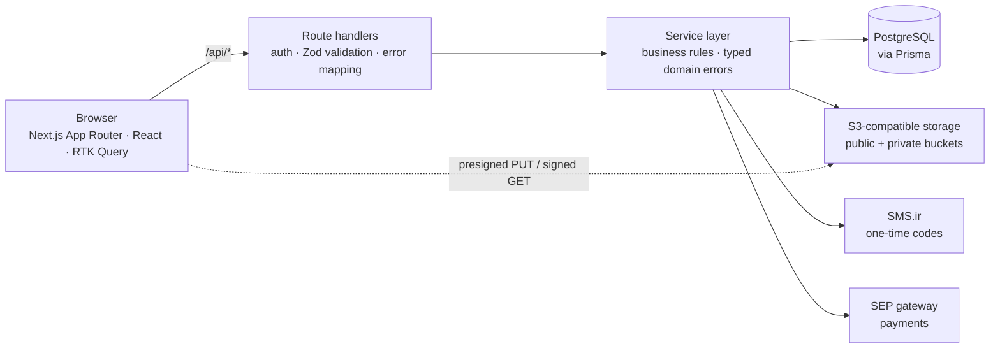

**Layering rule:** route handlers only authenticate, validate input with Zod and translate domain errors into HTTP status codes. All business rules live in services. Only one module knows about the storage provider, and only gateway adapters know about the bank.

```ts
// Route handler: thin, predictable
const parsed = UpdateCourseSchema.safeParse(await req.json());
if (!parsed.success)
  return NextResponse.json({ error: "ورودی نامعتبر" }, { status: 400 });

try {
  return NextResponse.json(await updateCourse(id, parsed.data));
} catch (err) {
  if (err instanceof CourseNotFoundError)
    return NextResponse.json({ error: err.message }, { status: 404 });
  if (err instanceof CourseSlugTakenError)
    return NextResponse.json({ error: err.message }, { status: 409 });
  throw err;
}
```

---

## Engineering highlights

### 1. Paid video and PDFs never leave the server as permanent links

**Problem:** Students pay for videos and recipe PDFs. A public URL in an API response would be shared within hours.

**Approach:**

- Private files live in a **private bucket**. The API **never returns their storage keys**, only `hasMainVideo` / `hasRecipePdf` booleans.
- The player asks `GET /api/courses/:id/protected-file`, which checks login → course → published state → admin or purchased access (free courses are open), and only then returns a **short-lived signed URL**.
- TTLs are chosen per file type: 5 minutes for PDFs, 4 hours for video so a long lesson does not expire mid-watch.
- Signing for the private bucket follows the provider's virtual-hosted style, and the visible host is swapped to a custom download domain while the signature stays valid.

```ts
// Serializer: paid files are never exposed, only a flag
function serializeCourse({ mainVideo, recipePdf, ...rest }) {
  return { ...rest, hasMainVideo: !!mainVideo, hasRecipePdf: !!recipePdf };
}

// GET /api/courses/:id/protected-file?type=video|recipe-pdf
const isAdmin = session.user.role === "admin";
const isFree = course.basePrice === 0 || course.salePrice === 0;

if (!isAdmin && course.status !== "PUBLISHED") return notFound();
if (!isAdmin && !isFree && !(await hasCourseAccess(session.user, id)))
  return forbidden();

const url = await getSignedDownloadUrlForKey(key, "private", ttlFor(type));
return NextResponse.json({ url }, { headers: { "Cache-Control": "no-store" } });
```

### 2. A storage layer that cannot drift away from the database

**Problem:** With direct browser uploads, files can be uploaded and never saved, replaced, or orphaned when a record is deleted. Deleting files inline with DB writes risks corrupting a successful transaction when the storage call fails.

**Approach:**

- **One module** talks to the provider (`s3.storage.ts`). Everything else works with a _scope_ (`public` / `private`) and a _key_. Moving to another S3-compatible provider means changing environment variables.
- **Keys are generated only on the server** (UUID under a per-purpose prefix). Each upload purpose declares its bucket scope, allowed MIME types, whether a course id is required, and whether only admins may request it.
- Browsers upload **directly to the bucket** through presigned PUT URLs, so large files never pass through the Next.js server.
- A `StorageObject` registry keeps a **reference count** per key. References are attached and released _inside the same transaction_ as the field update.
- Physical deletion is **never inline**. A cleanup job deletes objects that stayed unreferenced past a grace period, and re-checks each row before deleting.

```ts
[UploadPurpose.COURSE_MAIN_VIDEO]: {
  scope: "private",
  keyPrefix: (ctx) => `videos/courses/${ctx.courseId}/main`,
  allowedMimeTypes: ["video/mp4", "video/webm"],
  requiresCourseId: true,
  adminOnly: true,
},

await prisma.$transaction(async (tx) => {
  await tx.course.update({ where: { id }, data: { thumbnail: input.thumbnail } });
  // release the old key, attach the new one, atomically with the update
  await syncSingleKeyReference(existing.thumbnail, input.thumbnail, "public", tx);
});

// atomic decrement: concurrent releases cannot lose a count
export async function releaseReference(key: string | null | undefined, db: Db = prisma) {
  if (!key) return;
  const { count } = await db.storageObject.updateMany({
    where: { key, referenceCount: { gt: 0 } },
    data: { referenceCount: { decrement: 1 } },
  });
  if (count === 0) return;
  await db.storageObject.updateMany({
    where: { key, referenceCount: 0 },
    data: { unreferencedAt: new Date() }, // the cleanup job only touches rows past the grace period
  });
}
```

### 3. Payments: server-side pricing and idempotent finalization

**Problem:** A payment flow has to be correct even if the user refreshes, the bank calls back twice, or someone tampers with the request.

**Approach:**

- **The server decides every price.** Order items are rebuilt from the database (`salePrice ?? basePrice`) and stored as **snapshots** (title and price at purchase time). The client's cart is only for display.
- Coupons are validated against the live subtotal: validity window, minimum order, usage limit, per-user single use, user-targeted codes, and a cap for percentage discounts.
- The gateway sits behind an **adapter interface**: SEP in production, a TEST gateway for development.
- The bank callback is **not trusted**. The server verifies the `RefNum` with SEP, compares the verified **amount** with the order, and enforces a **unique receipt number** to block replay.
- Finalization runs in **one transaction** guarded by a status condition (`PENDING → PAID`), so concurrent or repeated finalizations cannot double-grant access. Network calls to the bank never happen inside a DB transaction.
- Abandoned attempts expire (payments after 20 minutes, orders after 60), so a user retrying a payment never loses their order.

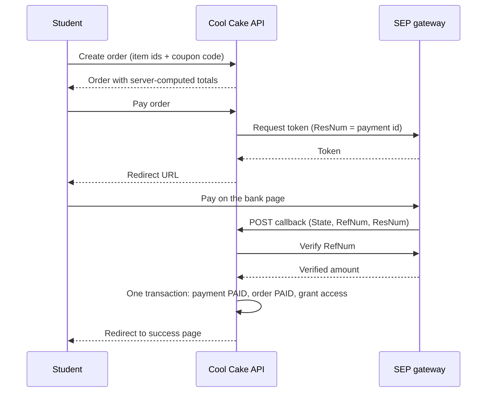

```ts
// Gateway adapter: the only code that knows SEP's API
export const sepGateway: PaymentGatewayAdapter = {
  gateway: "SEP",
  async getRedirectUrl(payment) {
    const res = await fetch(SEP_TOKEN_URL, {
      method: "POST",
      headers: { "Content-Type": "application/json" },
      body: JSON.stringify({
        action: "token",
        TerminalId: SEP_TERMINAL_ID,
        Amount: payment.amount, // integer, Rial
        ResNum: payment.id, // unique per attempt: used to match the callback
        RedirectUrl: SEP_CALLBACK_URL,
      }),
    });
    const data = (await res.json()) as SepTokenResponse;
    if (data.status !== 1 || !data.token)
      throw new Error(data.errorDesc || "خطا در اتصال به درگاه پرداخت");
    return {
      url: `https://sep.shaparak.ir/OnlinePG/SendToken?token=${data.token}`,
      authority: data.token,
    };
  },
};

// Callback: verify with the bank, never with the browser
if (payment.status === "PAID")
  return { status: "PAID", orderId: payment.orderId }; // repeat callback is a no-op
const verified = await verifyWithSep(refNum);
if (
  !verified.Success ||
  verified.OriginalAmount !== tomanToRial(Number(payment.amount))
) {
  await finalizePaymentFailure(payment.id);
  return { status: "FAILED", orderId: payment.orderId };
}

// Finalization: exactly one winner
const updated = await prisma.$transaction(async (tx) => {
  const claimed = await tx.payment.updateMany({
    where: { id: payment.id, status: "PENDING" },
    data: { status: "PAID", paidAt: now },
  });
  if (claimed.count === 0) return null; // someone else already finalized it

  await tx.order.updateMany({
    where: { id: order.id, status: { not: "PAID" } },
    data: { status: "PAID", paidAt: now },
  });
  for (const item of order.items) {
    if (item.courseId)
      await grantCourseAccess(tx, {
        userId,
        courseId: item.courseId,
        source: "DIRECT_PURCHASE",
      });
    else if (item.bundleId)
      await grantBundleAccess(tx, { userId, bundleId: item.bundleId });
  }
  return tx.order.findUniqueOrThrow({
    where: { id: order.id },
    include: { items: true },
  });
});
```

### 4. Full-text search for Persian without a Persian dictionary

**Problem:** PostgreSQL ships no Persian text-search configuration, and a plain `contains` filter gives neither ranking nor speed.

**Approach:**

- `tsvector` columns are **generated and stored** in the database, with the `simple` configuration (tokenize and lowercase, no English stemming) and **weights** (title › short description › description), each backed by a **GIN index**.
- One ranked query combines matches from courses, their category, tags and ingredients, with lower weights for indirect matches.
- Raw SQL goes through `Prisma.sql` as a **bound parameter**, and user input is sanitized into a valid prefix query, so typing "کی" already finds "کیک".
- Autocomplete returns **grouped suggestions** (courses, categories, tags, ingredients), each matched on its own name.

```sql
ALTER TABLE "Course"
  ADD COLUMN "searchVector" tsvector
  GENERATED ALWAYS AS (
    setweight(to_tsvector('simple', coalesce("title", '')), 'A') ||
    setweight(to_tsvector('simple', coalesce("shortDescription", '')), 'B') ||
    setweight(to_tsvector('simple', coalesce("description", '')), 'C')
  ) STORED;

CREATE INDEX "Course_searchVector_idx" ON "Course" USING GIN ("searchVector");
```

```ts
// Raw input -> safe prefix tsquery ("choco" matches "chocolate")
export function buildTsQuery(raw: string): string | null {
  const tokens = normalizePersian(raw) // Arabic ي/ك -> Persian ی/ک, half-space -> space
    .split(/\s+/)
    .map((t) => t.replace(/[^\p{L}\p{N}]/gu, "")) // strip every tsquery operator character
    .filter(Boolean);

  return tokens.length ? tokens.map((t) => `${t}:*`).join(" & ") : null;
}
```

### 5. A video player that survives expiring links

**Problem:** Signed URLs expire. A viewer who pauses for a long time or watches a long lesson should not hit an error screen, and progress should not be lost.

**Approach:**

- A video.js player wrapped in React. Callbacks are kept in refs, so the player is created once and never rebuilt on re-render.
- **Self-healing:** on a playback error, the player asks the API for a fresh signed URL, swaps the source, and **resumes at the same second**.
- **Progress tracking:** reported every N seconds, and also on pause, on end, and on unmount. The server never lets progress move backwards, and marks a course complete at 95%.
- Casual downloading is discouraged (`nodownload`, no Picture-in-Picture, no context menu).

```tsx
player.on("error", async () => {
  if (hasRetriedRef.current || !refreshSrcRef.current) return;
  hasRetriedRef.current = true;

  const resumeAt = player.currentTime() ?? 0;
  try {
    const freshUrl = await refreshSrcRef.current();
    player.error(null);
    player.src({ src: freshUrl, type: "video/mp4" });
    player.one("loadedmetadata", () => {
      hasRetriedRef.current = false; // allow another recovery later in the session
      player.currentTime(resumeAt);
      player.play()?.catch(() => {});
    });
  } catch {
    /* keep the original error visible */
  }
});

const reportProgress = () => {
  const duration = player.duration();
  if (!Number.isFinite(duration)) return; // metadata not loaded yet
  onProgressRef.current?.(player.currentTime() ?? 0, duration);
};
player.on("pause", reportProgress);
```

### 6. Phone-first authentication

- Students sign in with a **mobile number and an SMS code** (better-auth phone-number plugin, codes sent through SMS.ir). The account is created on first successful verification.
- Roles come from the better-auth admin plugin. Admin routes go through a single `requireAdmin` guard that distinguishes "not logged in" (401) from "not allowed" (403).
- Profile fields (first name, last name, birth date, gender) are additional typed user fields shared between server and client.

```ts
export async function requireAdmin(req: NextRequest) {
  const session = await auth.api.getSession({ headers: req.headers });
  if (!session)
    return NextResponse.json({ error: "ابتدا وارد شوید" }, { status: 401 });
  if (session.user.role !== "admin")
    return NextResponse.json({ error: "دسترسی غیرمجاز" }, { status: 403 });
  return session;
}
```

### 7. Admin course wizard: draft first, partial updates

- Step 1 creates a minimal **DRAFT** course. Every later step is a `PATCH` with only the fields that changed.
- The update schema has explicit semantics: **omitted = untouched · `null` = clear the file · array = replace the whole set**. Relations (tags, ingredients, images) are replaced inside a single transaction, together with their storage references.
- Referenced tags, ingredients and units are validated before anything is written. Storage objects are verified to exist before their keys are saved.

```ts
export const UpdateCourseSchema = z.object({
  thumbnail: z.string().min(1).nullable().optional(), // null clears the file
  salePrice: z.number().int().nonnegative().nullable().optional(),
  tagIds: z.array(z.string().min(1)).max(20).optional(), // replaces the whole set
  ingredients: z.array(CourseIngredientInputSchema).max(100).optional(),
  status: z.enum(["DRAFT", "PUBLISHED", "ARCHIVED"]).optional(),
});
```

### 8. Frontend craft: RTL, Persian formatting, accessibility, SEO

- **Right-to-left from the ground up:** layouts, carousels, directional icons and motion are designed for RTL. Numbers, prices, durations and dates use `Intl.NumberFormat("fa-IR")` and Persian "folio" numerals.
- **Responsive:** mobile bottom navigation, swipe carousels with snap and a peek of the next card, a sticky purchase bar on course and bundle pages.
- **Accessible carousels:** ARIA roles and labels, keyboard arrows, radio-group semantics for the finder, and `prefers-reduced-motion` support.
- **Loading states:** skeletons everywhere, `next/image` with sizes and priority for above-the-fold images.
- **SEO:** per-page metadata with canonical URLs and Open Graph images, request-level deduplication with React `cache()`, and proper `notFound()` handling.
- **RTK Query:** tag-based caching and invalidation, so admin edits refresh exactly the affected lists and details.

```ts
const numberFormatter = new Intl.NumberFormat("fa-IR");
export const formatPrice = (amount: number) =>
  `${numberFormatter.format(amount)} تومان`;
```

---

## Data model

31 Prisma models in a normalized PostgreSQL schema:

- **Identity:** `User`, `Session`, `Account`, `Verification`
- **Catalog:** `Category`, `Tag`, `Course`, `CourseTag`, `CourseImage`, `Ingredient`, `Unit`, `CourseIngredient`, `Recipe`, `RecipeStep`, `Bundle`, `BundleCourse`, `HeroSlide`
- **Commerce:** `Order`, `OrderItem` (price snapshots), `Payment`, `Coupon`, `CouponUser`
- **Learning and community:** `CourseAccess`, `CourseProgress`, `Wishlist`, `CourseReview`, `CourseQuestion`, `CourseAnswer`, `StudentSubmission`, `SiteReview`
- **Infrastructure:** `StorageObject` (file registry with reference counts)

Design choices worth noting: purchased access is a separate `CourseAccess` row with a _source_ (direct purchase, bundle purchase, admin grant); moderated content uses status enums; money and ratings are validated and recomputed on the server.

---

## Project facts

- **Solo delivery in about 25 days**, from empty repository to a live, paying platform.
- **Production data:** 80 courses, 5 bundles, 123 registered users.
- **Client project:** built for a pastry-education business, with real customers and real payments.

## Roadmap

- Direct browser uploads for protected videos and PDFs (the presigned pipeline already supports them).
- Adaptive streaming for long lessons.
- Search normalization applied at the index level, not only at query time.

---

## About me

**[Alireza Rezapour]** · Web developer · [https://github.com/Alireza-Rezapour] · [alirezarezapoor33@gmail.com]

If you would like a walkthrough of the code, the architecture or any of the decisions above, I would be glad to show it.


<div dir="rtl">

[English](README.md) | **فارسی**

# 🍰 Cool Cake — پلتفرم آموزش شیرینی‌پزی

**یک پلتفرم آموزش آنلاین فول‌استک و فارسی‌محور (راست‌به‌چپ) که هنرجویان در آن دوره‌های شیرینی و کیک را می‌خرند و تماشا می‌کنند. این پروژه را به‌تنهایی و در حدود ۲۵ روز طراحی، پیاده‌سازی و راه‌اندازی کرده‌ام و هم‌اکنون در محیط واقعی (Production) فعال است.**

🔗 **سایت فعال:** [cool-cake.ir](https://cool-cake.ir)

| | |
|---|---|
| **نقش من** | تنها توسعه‌دهنده: فرانت‌اند، بک‌اند، پایگاه‌داده، پرداخت، ذخیره‌سازی فایل و استقرار |
| **مدت پروژه** | حدود ۲۵ روز از شروع تا انتشار |
| **مقیاس فعلی** | ۸۰ دوره · ۵ بسته آموزشی · ۱۲۳ کاربر ثبت‌نام‌شده |
| **تکنولوژی‌ها** | Next.js (App Router) · TypeScript · Prisma · PostgreSQL · Redux Toolkit / RTK Query · Tailwind CSS · better-auth |
| **سورس‌کد** | خصوصی (پروژه‌ی کارفرمایی). با کمال میل هر بخش از آن را در یک جلسه توضیح می‌دهم. |

> این مخزن فقط برای معرفی پروژه است و شامل مستندات، تصاویر و بخش‌هایی کوتاه‌شده از کد می‌شود. قطعه‌کدهای زیر برای خوانایی ساده‌سازی شده‌اند.

---

## تصاویر

> اطلاعات شخصی در تصاویر (نام، شماره موبایل، ایمیل و درآمد) محو شده یا با داده‌ی نمونه جایگزین شده است.

| صفحه اصلی | صفحه دوره |
|---|---|
|  |  |

| جست‌وجو با پیشنهادهای دسته‌بندی‌شده | صفحه بسته آموزشی |
|---|---|
|  |  |

| سبد خرید و فیلد کد تخفیف | نظرات و نتایج هنرجویان |
|---|---|
|  |  |

| موبایل: «امروز چی بپزم؟» | موبایل: ورود با شماره موبایل |
|---|---|
|  |  |

| داشبورد هنرجو | داشبورد ادمین |
|---|---|
|  |  |

| ادمین: ویزارد ساخت دوره | ادمین: مدیریت دوره‌ها |
|---|---|
|  |  |

---

## این پلتفرم چه کار می‌کند؟

### برای هنرجویان
- **مرور و کشف:** دوره‌ها، دسته‌بندی‌ها، برچسب‌ها و بسته‌های آموزشی، به‌همراه یاب راهنمای **«امروز چی بپزم؟»** (بر اساس زمان در دسترس، نوع دسر و مواد اولیه‌ی موجود).
- **جست‌وجو:** جست‌وجوی تمام‌متن با رتبه‌بندی، فیلتر، مرتب‌سازی و پیشنهادهای خودکار دسته‌بندی‌شده (دوره‌ها، دسته‌بندی‌ها، برچسب‌ها و مواد اولیه).
- **ورود با موبایل:** ورود با شماره موبایل و کد یک‌بارمصرف پیامکی.
- **سبد خرید و پرداخت:** سبد خرید ماندگار، کد تخفیف و پرداخت آنلاین از طریق درگاه بانکی سپ (بانک سامان).
- **یادگیری:** ویدیوهای محافظت‌شده با امکان ادامه از جایی که متوقف شده‌اید، فایل PDF رسپی قابل دانلود، دستور پخت مرحله‌به‌مرحله و فهرست مواد اولیه.
- **جامعه‌ی هنرجویان:** نظرات تأییدشده همراه با پاسخ ادمین، پرسش و پاسخ، و عکس نتیجه‌ی کار هنرجویان.
- **داشبورد شخصی:** دوره‌های من، علاقه‌مندی‌ها، نظرات، پرسش‌ها، نتیجه‌کارها، کدهای تخفیف و پروفایل.

### برای ادمین
- **داشبورد:** روند درآمد، سفارش‌های موفق و در انتظار پرداخت، کاربران جدید و میزان استفاده از تخفیف‌ها، با بازه‌های ۷، ۳۰ و ۹۰ روزه و مقایسه با دوره‌ی قبل.
- **مدیریت محتوا:** دسته‌بندی‌ها، برچسب‌ها، مواد اولیه و واحدها، بسته‌های آموزشی و اسلایدهای صفحه اصلی (با دکمه‌ای که به یک دوره، بسته، دسته‌بندی یا برچسب لینک می‌شود).
- **ویزارد ساخت دوره:** شش مرحله (اطلاعات پایه و قیمت ← رسانه ← برچسب‌ها ← مواد اولیه ← دستور پخت ← انتشار) که ابتدا یک پیش‌نویس ساخته می‌شود.
- **کاربران و نظارت:** کاربران (جست‌وجو، فیلتر نقش و وضعیت، اعطا یا لغو دسترسی به دوره)، نظرات دوره‌ها، نظرات سایت، نتیجه‌کارهای هنرجویان و پاسخ به پرسش‌ها.
- **کدهای تخفیف:** درصدی یا مبلغ ثابت، حداقل مبلغ سفارش، سقف تخفیف، محدودیت تعداد استفاده، بازه‌ی اعتبار و تخصیص به کاربران مشخص.

---

## تکنولوژی‌ها

| لایه | تکنولوژی |
|---|---|
| فریم‌ورک | Next.js App Router، React، TypeScript |
| رابط کاربری | Tailwind CSS، shadcn/ui، Framer Motion، lucide-react |
| مدیریت داده در کلاینت | Redux Toolkit، RTK Query (کش و باطل‌سازی مبتنی بر تگ) |
| API | Route Handlerهای Next.js، اعتبارسنجی با Zod، لایه‌ی سرویس با خطاهای دامنه‌ای تایپ‌شده |
| پایگاه‌داده | PostgreSQL با Prisma (۳۱ مدل) و جست‌وجوی تمام‌متن با `tsvector` |
| احراز هویت | better-auth (کد یک‌بارمصرف با شماره موبایل، افزونه‌ی ادمین، نقش‌ها) و SMS.ir |
| پرداخت | درگاه سپ (بانک سامان) پشت یک Adapter، به‌همراه درگاه TEST برای توسعه |
| ذخیره‌سازی فایل | ذخیره‌ساز سازگار با S3 (لیارا) با باکت عمومی و خصوصی و لینک‌های پیش‌امضاشده |
| ویدیو | video.js |
| میزبانی | Runflare |

---

## معماری

<div dir="ltr">


</div>

**قاعده‌ی لایه‌بندی:** Route Handlerها فقط کاربر را احراز هویت می‌کنند، ورودی را با Zod اعتبارسنجی می‌کنند و خطاهای دامنه را به کد وضعیت HTTP تبدیل می‌کنند. تمام قوانین کسب‌وکار در سرویس‌ها هستند. فقط یک ماژول از ارائه‌دهنده‌ی ذخیره‌سازی خبر دارد و فقط Adapterهای درگاه با بانک ارتباط دارند.

<div dir="ltr">

```ts
// Route handler: thin, predictable
const parsed = UpdateCourseSchema.safeParse(await req.json());
if (!parsed.success) return NextResponse.json({ error: "ورودی نامعتبر" }, { status: 400 });

try {
  return NextResponse.json(await updateCourse(id, parsed.data));
} catch (err) {
  if (err instanceof CourseNotFoundError) return NextResponse.json({ error: err.message }, { status: 404 });
  if (err instanceof CourseSlugTakenError) return NextResponse.json({ error: err.message }, { status: 409 });
  throw err;
}
```

</div>

---

## نکات برجسته‌ی مهندسی

### ۱. ویدیو و PDFهای پولی هرگز به‌صورت لینک دائمی از سرور خارج نمی‌شوند

**مسئله:** هنرجویان برای ویدیو و PDF رسپی پول می‌دهند. اگر آدرس عمومی فایل در پاسخ API باشد، در چند ساعت دست‌به‌دست می‌شود.

**راه‌حل:**
- فایل‌های خصوصی در یک **باکت خصوصی** نگهداری می‌شوند. API هرگز **کلید ذخیره‌سازی** آن‌ها را برنمی‌گرداند و فقط مقدار `hasMainVideo` / `hasRecipePdf` را ارسال می‌کند.
- پلیر از `GET /api/courses/:id/protected-file` درخواست می‌کند. این مسیر به‌ترتیب ورود کاربر ← وجود دوره ← منتشرشده‌بودن ← ادمین‌بودن یا خرید دوره را بررسی می‌کند (دوره‌های رایگان باز هستند) و تازه بعد از آن یک **لینک امضاشده‌ی کوتاه‌مدت** برمی‌گرداند.
- زمان انقضا بر اساس نوع فایل تنظیم شده است: ۵ دقیقه برای PDF و ۴ ساعت برای ویدیو، تا درس‌های طولانی وسط تماشا منقضی نشوند.
- امضای لینک برای باکت خصوصی مطابق سبک virtual-hosted ارائه‌دهنده انجام می‌شود و نام دامنه‌ی قابل‌مشاهده به یک دامنه‌ی دانلود اختصاصی تغییر می‌کند، بدون آن‌که امضا باطل شود.

<div dir="ltr">

```ts
// Serializer: paid files are never exposed, only a flag
function serializeCourse({ mainVideo, recipePdf, ...rest }) {
  return { ...rest, hasMainVideo: !!mainVideo, hasRecipePdf: !!recipePdf };
}

// GET /api/courses/:id/protected-file?type=video|recipe-pdf
const isAdmin = session.user.role === "admin";
const isFree = course.basePrice === 0 || course.salePrice === 0;

if (!isAdmin && course.status !== "PUBLISHED") return notFound();
if (!isAdmin && !isFree && !(await hasCourseAccess(session.user, id))) return forbidden();

const url = await getSignedDownloadUrlForKey(key, "private", ttlFor(type));
return NextResponse.json({ url }, { headers: { "Cache-Control": "no-store" } });
```

</div>

### ۲. لایه‌ی ذخیره‌سازی که هرگز با پایگاه‌داده ناهماهنگ نمی‌شود

**مسئله:** در آپلود مستقیم از مرورگر، فایل‌ها ممکن است آپلود شوند ولی هیچ‌وقت ذخیره نشوند، جایگزین شوند یا بعد از حذف رکورد یتیم بمانند. حذف فایل هم‌زمان با نوشتن در پایگاه‌داده هم خطرناک است، چون اگر فراخوانی ذخیره‌سازی شکست بخورد، یک تراکنش موفق خراب می‌شود.

**راه‌حل:**
- **فقط یک ماژول** با ارائه‌دهنده صحبت می‌کند (`s3.storage.ts`). بقیه‌ی کد فقط با *scope* (`public` / `private`) و *key* کار می‌کند. رفتن به یک ارائه‌دهنده‌ی دیگر سازگار با S3 یعنی تغییر متغیرهای محیطی.
- **کلیدها فقط در سرور ساخته می‌شوند** (UUID زیر یک پیشوند مخصوص هر کاربرد). هر «هدف آپلود» باکت، نوع‌های MIME مجاز، نیاز به شناسه‌ی دوره و ادمینی‌بودن را مشخص می‌کند.
- مرورگر از طریق لینک‌های PUT پیش‌امضاشده **مستقیماً به باکت** آپلود می‌کند، بنابراین فایل‌های حجیم هیچ‌وقت از سرور Next.js عبور نمی‌کنند.
- یک رجیستری به نام `StorageObject` برای هر کلید یک **شمارنده‌ی ارجاع** نگه می‌دارد. ارجاع‌ها *داخل همان تراکنشی* که فیلد را به‌روز می‌کند اضافه یا آزاد می‌شوند.
- حذف فیزیکی **هرگز هم‌زمان** انجام نمی‌شود. یک Job پاک‌سازی، آبجکت‌هایی را که بعد از یک مهلت مشخص هنوز بدون ارجاع مانده‌اند حذف می‌کند و پیش از حذف هر ردیف دوباره وضعیتش را بررسی می‌کند.

<div dir="ltr">

```ts
[UploadPurpose.COURSE_MAIN_VIDEO]: {
  scope: "private",
  keyPrefix: (ctx) => `videos/courses/${ctx.courseId}/main`,
  allowedMimeTypes: ["video/mp4", "video/webm"],
  requiresCourseId: true,
  adminOnly: true,
},

await prisma.$transaction(async (tx) => {
  await tx.course.update({ where: { id }, data: { thumbnail: input.thumbnail } });
  // release the old key, attach the new one, atomically with the update
  await syncSingleKeyReference(existing.thumbnail, input.thumbnail, "public", tx);
});

// atomic decrement: concurrent releases cannot lose a count
export async function releaseReference(key: string | null | undefined, db: Db = prisma) {
  if (!key) return;
  const { count } = await db.storageObject.updateMany({
    where: { key, referenceCount: { gt: 0 } },
    data: { referenceCount: { decrement: 1 } },
  });
  if (count === 0) return;
  await db.storageObject.updateMany({
    where: { key, referenceCount: 0 },
    data: { unreferencedAt: new Date() }, // the cleanup job only touches rows past the grace period
  });
}
```

</div>

### ۳. پرداخت: قیمت‌گذاری سمت سرور و نهایی‌سازی ایدمپوتنت

**مسئله:** جریان پرداخت باید حتی وقتی کاربر صفحه را رفرش می‌کند، بانک دوبار callback می‌زند یا کسی درخواست را دست‌کاری می‌کند، درست کار کند.

**راه‌حل:**
- **تمام قیمت‌ها را سرور تعیین می‌کند.** آیتم‌های سفارش از پایگاه‌داده بازسازی می‌شوند (`salePrice ?? basePrice`) و به‌صورت **اسنپ‌شات** (عنوان و قیمت در لحظه‌ی خرید) ذخیره می‌شوند. سبد خرید سمت کلاینت فقط برای نمایش است.
- کد تخفیف روی جمع واقعی سفارش اعتبارسنجی می‌شود: بازه‌ی اعتبار، حداقل مبلغ، محدودیت تعداد استفاده، یک‌بار استفاده برای هر کاربر، کدهای مخصوص کاربران مشخص و سقف تخفیف برای کدهای درصدی.
- درگاه پشت یک **رابط Adapter** قرار دارد: سپ در محیط واقعی و یک درگاه TEST برای توسعه.
- callback بانک **مورد اعتماد نیست.** سرور `RefNum` را از خود سپ تأیید می‌کند، **مبلغ** تأییدشده را با سفارش مقایسه می‌کند و با **یکتا بودن شماره‌ی رسید** جلوی تکرار (Replay) را می‌گیرد.
- نهایی‌سازی در **یک تراکنش** و با شرط وضعیت (`PENDING ← PAID`) انجام می‌شود، پس نهایی‌سازی هم‌زمان یا تکراری نمی‌تواند دوبار دسترسی بدهد. فراخوانی شبکه به بانک هیچ‌وقت داخل تراکنش پایگاه‌داده انجام نمی‌شود.
- تلاش‌های رهاشده منقضی می‌شوند (پرداخت‌ها بعد از ۲۰ دقیقه و سفارش‌ها بعد از ۶۰ دقیقه)، پس کاربری که دوباره پرداخت را امتحان می‌کند سفارشش را از دست نمی‌دهد.

<div dir="ltr">


</div>

<div dir="ltr">

```ts
// Gateway adapter: the only code that knows SEP's API
export const sepGateway: PaymentGatewayAdapter = {
  gateway: "SEP",
  async getRedirectUrl(payment) {
    const res = await fetch(SEP_TOKEN_URL, {
      method: "POST",
      headers: { "Content-Type": "application/json" },
      body: JSON.stringify({
        action: "token",
        TerminalId: SEP_TERMINAL_ID,
        Amount: payment.amount,   // integer, Rial
        ResNum: payment.id,       // unique per attempt: used to match the callback
        RedirectUrl: SEP_CALLBACK_URL,
      }),
    });
    const data = (await res.json()) as SepTokenResponse;
    if (data.status !== 1 || !data.token) throw new Error(data.errorDesc || "خطا در اتصال به درگاه پرداخت");
    return { url: `https://sep.shaparak.ir/OnlinePG/SendToken?token=${data.token}`, authority: data.token };
  },
};

// Callback: verify with the bank, never with the browser
if (payment.status === "PAID") return { status: "PAID", orderId: payment.orderId }; // repeat callback is a no-op
const verified = await verifyWithSep(refNum);
if (!verified.Success || verified.TransactionDetail?.OrginalAmount !== tomanToRial(Number(payment.amount))) {
  await finalizePaymentFailure(payment.id);
  return { status: "FAILED", orderId: payment.orderId };
}

// Finalization: exactly one winner
const updated = await prisma.$transaction(async (tx) => {
  const claimed = await tx.payment.updateMany({
    where: { id: payment.id, status: "PENDING" },
    data: { status: "PAID", paidAt: now },
  });
  if (claimed.count === 0) return null; // someone else already finalized it

  await tx.order.updateMany({ where: { id: order.id, status: { not: "PAID" } }, data: { status: "PAID", paidAt: now } });
  for (const item of order.items) {
    if (item.courseId) await grantCourseAccess(tx, { userId, courseId: item.courseId, source: "DIRECT_PURCHASE" });
    else if (item.bundleId) await grantBundleAccess(tx, { userId, bundleId: item.bundleId });
  }
  return tx.order.findUniqueOrThrow({ where: { id: order.id }, include: { items: true } });
});
```

</div>

### ۴. جست‌وجوی تمام‌متن فارسی بدون دیکشنری فارسی

**مسئله:** PostgreSQL هیچ پیکربندی جست‌وجوی متنی برای فارسی ندارد و فیلتر ساده‌ی `contains` نه رتبه‌بندی دارد و نه سریع است.

**راه‌حل:**
- ستون‌های `tsvector` به‌صورت **تولیدشده و ذخیره‌شده** در پایگاه‌داده تعریف شده‌اند، با پیکربندی `simple` (شکستن به کلمه و حروف کوچک، بدون ریشه‌یابی انگلیسی) و **وزن‌دهی** (عنوان › توضیح کوتاه › توضیح کامل) و هرکدام با یک **ایندکس GIN**.
- یک کوئری رتبه‌بندی‌شده، نتایج دوره، دسته‌بندی، برچسب‌ها و مواد اولیه را ترکیب می‌کند و برای تطابق‌های غیرمستقیم وزن کمتری می‌دهد.
- SQL خام از طریق `Prisma.sql` و به‌صورت **پارامتر بایندشده** اجرا می‌شود و ورودی کاربر به یک کوئری پیشوندی معتبر پاک‌سازی می‌شود؛ بنابراین با تایپ «کی» همین حالا «کیک» پیدا می‌شود.
- پیشنهاد خودکار (Autocomplete) نتایج را **دسته‌بندی‌شده** برمی‌گرداند (دوره‌ها، دسته‌بندی‌ها، برچسب‌ها و مواد اولیه) و هرکدام را روی نام خودش جست‌وجو می‌کند.

<div dir="ltr">

```sql
ALTER TABLE "Course"
  ADD COLUMN "searchVector" tsvector
  GENERATED ALWAYS AS (
    setweight(to_tsvector('simple', coalesce("title", '')), 'A') ||
    setweight(to_tsvector('simple', coalesce("shortDescription", '')), 'B') ||
    setweight(to_tsvector('simple', coalesce("description", '')), 'C')
  ) STORED;

CREATE INDEX "Course_searchVector_idx" ON "Course" USING GIN ("searchVector");
```

</div>

<div dir="ltr">

```ts
// Raw input -> safe prefix tsquery ("choco" matches "chocolate")
export function buildTsQuery(raw: string): string | null {
  const tokens = normalizePersian(raw)               // Arabic ي/ك -> Persian ی/ک, half-space -> space
    .split(/\s+/)
    .map((t) => t.replace(/[^\p{L}\p{N}]/gu, ""))    // strip every tsquery operator character
    .filter(Boolean);

  return tokens.length ? tokens.map((t) => `${t}:*`).join(" & ") : null;
}
```

</div>

### ۵. پلیر ویدیویی که با منقضی‌شدن لینک از کار نمی‌افتد

**مسئله:** لینک‌های امضاشده منقضی می‌شوند. کسی که مدت طولانی ویدیو را متوقف می‌کند یا یک درس طولانی را می‌بیند نباید با صفحه‌ی خطا روبه‌رو شود و پیشرفتش هم نباید از بین برود.

**راه‌حل:**
- پلیر video.js که داخل React پیچیده شده است. تابع‌های ورودی در `ref` نگهداری می‌شوند، پس پلیر فقط یک‌بار ساخته می‌شود و با هر رندر دوباره ساخته نمی‌شود.
- **خود‌ترمیمی:** وقتی پخش خطا می‌دهد، پلیر یک لینک امضاشده‌ی تازه از API می‌گیرد، منبع را عوض می‌کند و **از همان ثانیه‌ای که بود ادامه می‌دهد.**
- **ثبت پیشرفت:** هر N ثانیه و همچنین هنگام توقف، پایان ویدیو و خروج از صفحه گزارش می‌شود. سرور اجازه نمی‌دهد پیشرفت عقب برود و دوره را در ۹۵٪ تکمیل‌شده ثبت می‌کند.
- از دانلود ساده جلوگیری می‌شود (`nodownload`، بدون Picture-in-Picture و بدون منوی راست‌کلیک).

<div dir="ltr">

```tsx
player.on("error", async () => {
  if (hasRetriedRef.current || !refreshSrcRef.current) return;
  hasRetriedRef.current = true;

  const resumeAt = player.currentTime() ?? 0;
  try {
    const freshUrl = await refreshSrcRef.current();
    player.error(null);
    player.src({ src: freshUrl, type: "video/mp4" });
    player.one("loadedmetadata", () => {
      hasRetriedRef.current = false;         // allow another recovery later in the session
      player.currentTime(resumeAt);
      player.play()?.catch(() => {});
    });
  } catch { /* keep the original error visible */ }
});

const reportProgress = () => {
  const duration = player.duration();
  if (!Number.isFinite(duration)) return;     // metadata not loaded yet
  onProgressRef.current?.(player.currentTime() ?? 0, duration);
};
player.on("pause", reportProgress);
```

</div>

### ۶. احراز هویت مبتنی بر شماره موبایل

- هنرجویان با **شماره موبایل و کد پیامکی** وارد می‌شوند (افزونه‌ی phone-number در better-auth و ارسال کد از طریق SMS.ir). حساب کاربری در اولین تأیید موفق ساخته می‌شود.
- نقش‌ها از افزونه‌ی ادمین better-auth می‌آیند. مسیرهای ادمین از یک گارد واحد به نام `requireAdmin` عبور می‌کنند که «وارد نشده» (۴۰۱) را از «دسترسی غیرمجاز» (۴۰۳) جدا می‌کند.
- فیلدهای پروفایل (نام، نام خانوادگی، تاریخ تولد، جنسیت) فیلدهای اضافه‌ی تایپ‌شده‌ای هستند که بین سرور و کلاینت مشترک‌اند.

<div dir="ltr">

```ts
export async function requireAdmin(req: NextRequest) {
  const session = await auth.api.getSession({ headers: req.headers });
  if (!session) return NextResponse.json({ error: "ابتدا وارد شوید" }, { status: 401 });
  if (session.user.role !== "admin") return NextResponse.json({ error: "دسترسی غیرمجاز" }, { status: 403 });
  return session;
}
```

</div>

### ۷. ویزارد ساخت دوره در پنل ادمین: ابتدا پیش‌نویس، سپس به‌روزرسانی جزئی

- مرحله‌ی اول یک دوره‌ی حداقلی با وضعیت **DRAFT** می‌سازد. هر مرحله‌ی بعد یک `PATCH` است که فقط فیلدهای تغییرکرده را می‌فرستد.
- اسکیمای به‌روزرسانی معنای دقیق و روشنی دارد: **حذف‌شده = دست‌نخورده · `null` = پاک کردن فایل · آرایه = جایگزینی کل مجموعه.** روابط (برچسب‌ها، مواد اولیه، تصاویر) همراه با ارجاع‌های فایلشان در یک تراکنش جایگزین می‌شوند.
- برچسب‌ها، مواد اولیه و واحدهای ارجاع‌شده پیش از هر نوشتنی اعتبارسنجی می‌شوند. کلیدهای فایل خصوصی هم پیش از ذخیره بررسی می‌شوند که واقعاً وجود دارند.

<div dir="ltr">

```ts
export const UpdateCourseSchema = z.object({
  thumbnail: z.string().min(1).nullable().optional(),        // null clears the file
  salePrice: z.number().int().nonnegative().nullable().optional(),
  tagIds: z.array(z.string().min(1)).max(20).optional(),     // replaces the whole set
  ingredients: z.array(CourseIngredientInputSchema).max(100).optional(),
  status: z.enum(["DRAFT", "PUBLISHED", "ARCHIVED"]).optional(),
});
```

</div>

### ۸. جزئیات فرانت‌اند: راست‌به‌چپ، قالب‌بندی فارسی، دسترس‌پذیری و SEO

- **راست‌به‌چپ از پایه:** چیدمان‌ها، کاروسل‌ها، آیکن‌های جهت‌دار و انیمیشن‌ها برای RTL طراحی شده‌اند. اعداد، قیمت‌ها، مدت‌زمان‌ها و تاریخ‌ها با `Intl.NumberFormat("fa-IR")` و شماره‌گذاری فارسی نمایش داده می‌شوند.
- **واکنش‌گرا:** نوار ناوبری پایین در موبایل، کاروسل‌های قابل‌کشیدن با snap و نمایش بخشی از کارت بعدی، و نوار خرید چسبان در صفحه‌های دوره و بسته.
- **کاروسل‌های دسترس‌پذیر:** نقش‌ها و برچسب‌های ARIA، کلیدهای جهت‌نما، معنای radio-group برای یاب «امروز چی بپزم؟» و پشتیبانی از `prefers-reduced-motion`.
- **حالت‌های بارگذاری:** اسکلت‌های بارگذاری (Skeleton) در همه‌جا و `next/image` با `sizes` و `priority` برای تصاویر بالای صفحه.
- **SEO:** متادیتا برای هر صفحه با آدرس canonical و تصاویر Open Graph، حذف درخواست‌های تکراری با `cache()` در React و مدیریت درست `notFound()`.
- **RTK Query:** کش و باطل‌سازی مبتنی بر تگ، تا ویرایش‌های ادمین دقیقاً همان فهرست‌ها و جزئیات مرتبط را تازه کند.

<div dir="ltr">

```ts
const numberFormatter = new Intl.NumberFormat("fa-IR");
export const formatPrice = (amount: number) => `${numberFormatter.format(amount)} تومان`;
```

</div>

---

## مدل داده

۳۱ مدل Prisma در یک طرح نرمال‌شده‌ی PostgreSQL:

- **هویت:** `User`، `Session`، `Account`، `Verification`
- **کاتالوگ:** `Category`، `Tag`، `Course`، `CourseTag`، `CourseImage`، `Ingredient`، `Unit`، `CourseIngredient`، `Recipe`، `RecipeStep`، `Bundle`، `BundleCourse`، `HeroSlide`
- **تجارت:** `Order`، `OrderItem` (اسنپ‌شات قیمت)، `Payment`، `Coupon`، `CouponUser`
- **یادگیری و جامعه:** `CourseAccess`، `CourseProgress`، `Wishlist`، `CourseReview`، `CourseQuestion`، `CourseAnswer`، `StudentSubmission`، `SiteReview`
- **زیرساخت:** `StorageObject` (رجیستری فایل‌ها با شمارنده‌ی ارجاع)

نکته‌های طراحی: دسترسی خریداری‌شده یک ردیف جداگانه‌ی `CourseAccess` با *منبع* است (خرید مستقیم، خرید بسته، اعطای ادمین)؛ محتوای نیازمند تأیید از enumهای وضعیت استفاده می‌کند؛ مبلغ‌ها و امتیازها در سرور اعتبارسنجی و دوباره محاسبه می‌شوند.

---

## واقعیت‌های پروژه

- **تحویل تک‌نفره در حدود ۲۵ روز**، از مخزن خالی تا یک پلتفرم زنده و درحال‌فروش.
- **داده‌ی واقعی:** ۸۰ دوره، ۵ بسته و ۱۲۳ کاربر ثبت‌نام‌شده.
- **پروژه‌ی کارفرمایی:** برای یک کسب‌وکار آموزش شیرینی‌پزی، با مشتریان و پرداخت‌های واقعی.

## نقشه‌ی راه

- آپلود مستقیم از مرورگر برای ویدیوها و PDFهای محافظت‌شده (زیرساخت لینک پیش‌امضاشده از قبل از آن‌ها پشتیبانی می‌کند).
- پخش تطبیقی (Adaptive Streaming) برای درس‌های طولانی.
- اعمال نرمال‌سازی جست‌وجو در سطح ایندکس، نه فقط در زمان کوئری.

---

## درباره‌ی من

**[علیرضا رضاپور]** · توسعه‌دهنده‌ی وب · [https://github.com/Alireza-Rezapour] · [alirezarezapoor33@gmail.com]

اگر می‌خواهید کد، معماری یا هر یک از تصمیم‌های بالا را با هم مرور کنیم، خوشحال می‌شوم آن را نشان بدهم.

</div>
